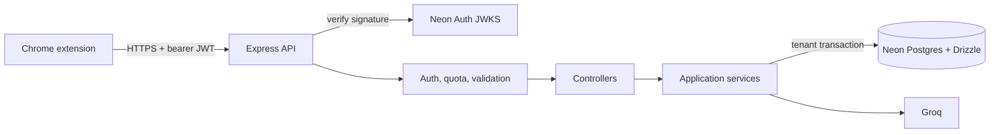

# Smart Web Assistant

Chrome extension that extracts readable page text and lets a signed-in user ask Groq-backed questions about it. The extension runs separately from the Node/Express API. Deployment steps are in [DEPLOYMENT.md](DEPLOYMENT.md).

## Architecture

- `extension/`: Manifest V3 popup, DOM extraction, Neon Auth email/password sign-in, and HTTPS API client.
- `server/src/app.js`: HTTP composition root. It applies security headers, exact-origin CORS, request IDs, authentication, shared quotas, body limits, routes, and error handling.
- `server/src/controllers/`: HTTP adapters only. They translate validated requests into application service calls.
- `server/src/services/`: use cases for chatting and conversation management. Chat history is read from the server database, not accepted from the client.
- `server/src/db/`: Drizzle persistence, atomic chat writes, ownership-scoped queries, and Postgres-backed rate limits.
- `server/src/middleware/`: Neon Auth JWT verification, validation, request context, and user rate limiting.
- `server/src/config/`: validated environment configuration and the bounded Groq model list.
- `server/drizzle/`: ordered SQL migrations. Apply migrations before starting a release.

Neon Auth owns credentials and sessions. The API verifies JWT signatures against its JWKS and uses the signed UUID subject as the data owner. Every user-owned query runs inside a transaction that sets the verified owner locally; forced Postgres row level security and ownership-scoped SQL both enforce tenant boundaries. Composite foreign keys prevent a message from being attached to another user's conversation, and a database sequence preserves message order. Each chat exchange commits in one transaction. No API request trusts a user ID supplied in its body.

The Node service uses Neon's pooled PostgreSQL driver because chat persistence and limiter updates need transaction and session support. Per-user quotas live in Postgres, so Cloud Run instances share them. Each instance has a bounded connection pool; set the Cloud Run maximum instance count with the Neon connection budget in mind.

Operational endpoints are public: `/api/health` is a lightweight liveness response, `/api/ready` checks Postgres, and `/api/auth-config` exposes only the public Neon Auth URL. All user data routes require a signed bearer token.

## Local development

1. Create a Neon project, enable Neon Auth, and copy its database URL, auth base URL, and JWKS URL into `server/.env` (start from `.env.example`).
2. Run `cd server && npm install`, then `npm run db:migrate` and `npm start`.
3. In `extension/config.js`, set `API_BASE_URL` to `http://localhost:3000`. Add that origin to extension `host_permissions` for local development.
4. Load `extension/` in `chrome://extensions` with Developer mode enabled. Add `chrome-extension://YOUR_EXTENSION_ID` to `CORS_ORIGINS` and the Neon Auth trusted origins, then restart the API and reload the extension.
5. Create an account in extension settings. If Neon Auth email verification is enabled, verify the address before signing in.

Run the isolated server checks with `cd server && npm test`.

## Security and deployment notes

- Keep `DATABASE_URL` and any server-side `GROQ_API_KEY` in the hosting provider's secret manager. Never bundle them into the extension or commit `.env`.
- `NEON_AUTH_BASE_URL` and `NEON_AUTH_JWKS_URL` are public endpoints. The API verifies bearer JWT signatures using Neon Auth's JWKS and scopes all stored data to the verified `sub` claim.
- Use HTTPS for public deployment. Configure Neon Auth to trust only the deployed extension origin and enable email verification before opening sign-up.
- Neon Managed Better Auth allows anyone to sign up by default. Require email verification and add an application invite or allowlist gate before public launch; provider-side restricted signup is not available in the current auth flow.
- The API applies database-backed per-user quotas. Rate limiting fails closed when Postgres is unavailable. Add an edge-level abuse control before opening unrestricted public sign-up.
- The extension uses the checked-in Neon Auth browser client bundle at `extension/neon-auth.bundle.js`. It does not load executable code from a remote server.

## Current boundaries

DOM extraction is heuristic and caps the content sent upstream; it is not a dedicated Readability parser. Recent popup state stays in browser-local storage per account, while canonical conversation history is stored in Neon Postgres. Configure provider spend limits and review signup controls before broad public use.
